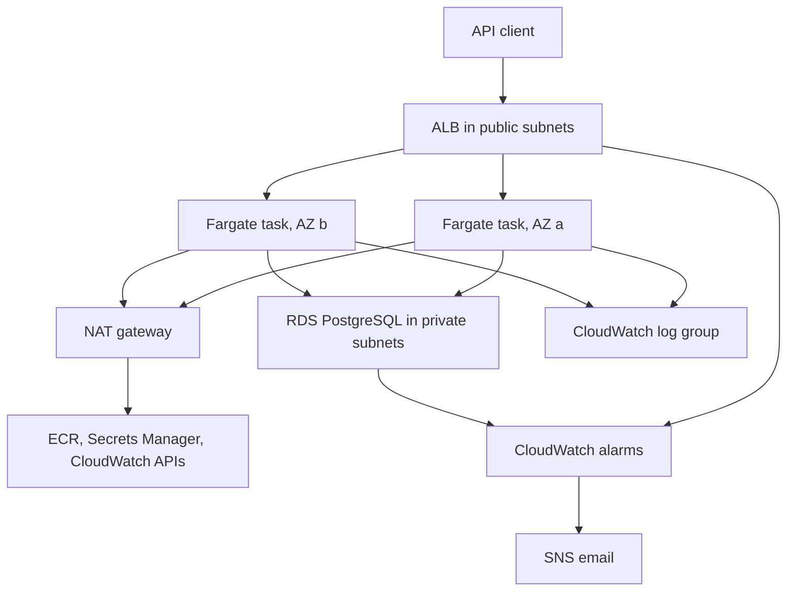
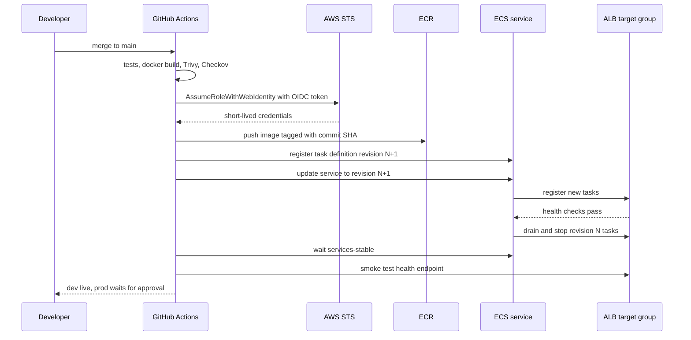
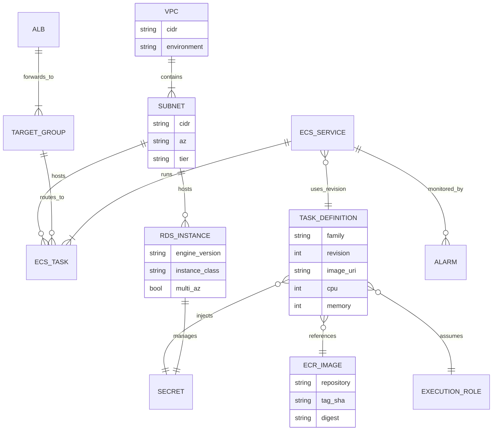
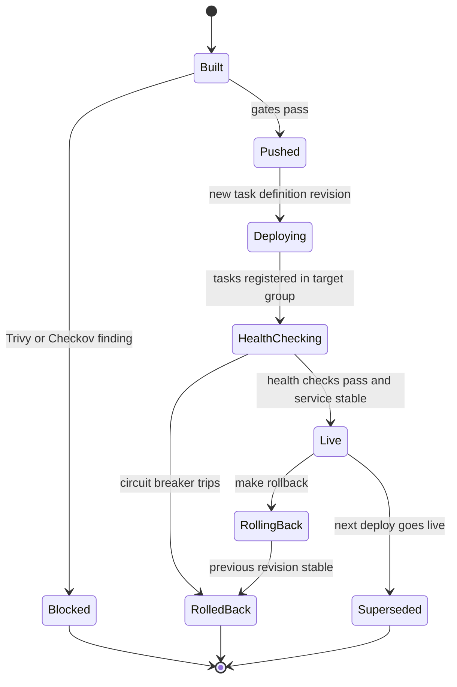
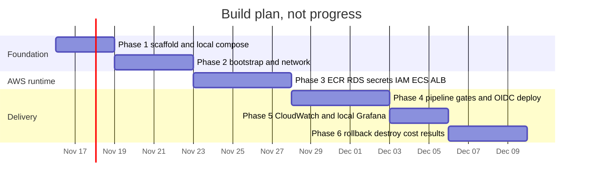

# Endurance – AWS DevOps: interview prep

Companion notes for explaining this project in DevOps and cloud engineer interviews. Nothing here is a measured result yet; every outcome is a blank to fill from real runs (raw output in `docs/results/`).

---

## At a glance

### 30-second pitch

I took Ironbank, a payments API I wrote, and deployed it to AWS the way a platform team would. Everything is Terraform: a VPC with private subnets, an ECS Fargate service behind a load balancer, RDS PostgreSQL, ECR, Secrets Manager, CloudWatch alarms and least-privilege IAM, with remote state in S3 and a DynamoDB lock. GitHub Actions gets into AWS through OIDC, so there are no stored keys, and it will not deploy if Trivy finds a serious vulnerability in the image or Checkov finds a misconfiguration in the Terraform. I can roll back with one command and tear the whole thing down with `make destroy`.

### 2-minute walkthrough

1. **The problem.** I wanted to show that I can run a service, not just write one. So the goal was a deployment I could rebuild from scratch, ship safely, watch, roll back and switch off.
2. **Infrastructure.** Terraform is split into modules: network, ECR, database, IAM, service and monitoring. One root module takes a `dev.tfvars` or `prod.tfvars`, so both environments are built from the same code and only differ in sizes and safety settings. State lives in a versioned S3 bucket with a DynamoDB lock table, created by a small bootstrap stack.
3. **Network and runtime.** Only the load balancer is public. The Fargate tasks and the database are in private subnets, and security groups only allow ALB to tasks and tasks to database. The database password is generated by RDS and kept in Secrets Manager; the task reads it at start-up, so it never lands in my code or my Terraform state.
4. **Pipeline.** On a pull request, GitHub Actions lints the Terraform, runs Ironbank's tests, builds the image and runs Trivy and Checkov. If those pass it shows a `terraform plan`. On merge, it assumes an AWS role through OIDC, pushes the image to ECR tagged with the commit SHA, registers a new task definition and updates the ECS service in dev, runs a smoke test, then waits for my approval before doing the same in prod.
5. **Operations.** CloudWatch alarms on 5xx errors, latency, unhealthy hosts, CPU and database storage email me through SNS. Locally I run Prometheus and Grafana with Docker Compose for a request rate, error and latency dashboard. Rollback means pointing the service back at the previous task definition revision, and the ECS circuit breaker does that automatically if a deploy never gets healthy.
6. **Results.** I measured deploy lead time of [measured], pipeline duration of [measured], rollback time of [measured], and the gates blocked [measured] findings. The monthly cost estimate for dev is [measured].

---

## Tech stack deep dive

| Tool | What it does here | Why this and not the alternative |
|---|---|---|
| Terraform | Defines every AWS resource as modules, applied per environment | Not CloudFormation/CDK: cloud-agnostic, readable plans, more common in job posts; not Pulumi: HCL is the industry default for IaC reviews |
| S3 + DynamoDB backend | Stores shared state and locks it during applies | Not local state: CI and humans need the same state; not Terraform Cloud: stays inside the AWS account at near-zero cost |
| VPC and subnets | Public subnets for ALB and NAT, private subnets for tasks and RDS | Not default VPC: default subnets are public, which would expose tasks and the DB |
| NAT gateway | Lets private tasks reach ECR, Secrets Manager and CloudWatch | Not VPC interface endpoints: several endpoints across two AZs cost more than one NAT at this size; not public IPs on tasks: puts tasks on the internet |
| ECS Fargate | Runs the Ironbank container as a service | Not EKS: no control plane to pay for or run for one API; not EC2: no hosts to patch; not Lambda: long-running API with a DB connection pool |
| ALB | Routes traffic to healthy tasks, health checks, rolling deploys | Not NLB: needs HTTP-level health checks and routing; not API Gateway: plain HTTP service, no per-request pricing needed |
| RDS PostgreSQL | Ironbank's database with backups and encryption | Not Postgres in a container: no durable storage or backups on Fargate; not Aurora: more cost for features a demo does not need |
| ECR | Stores images with immutable SHA tags | Not Docker Hub: private, same account, IAM-controlled pulls, no rate limits |
| Secrets Manager | Holds the RDS-managed master password | Not SSM Parameter Store: RDS manages and rotates the secret natively in Secrets Manager |
| CloudWatch | Logs, alarms, SNS email | Not a self-hosted stack in AWS: no extra always-on compute to pay for |
| IAM + GitHub OIDC | Short-lived CI credentials, least-privilege runtime roles | Not access keys in GitHub secrets: those never expire and leak easily |
| GitHub Actions | CI/CD with a manual approval on the prod environment | Not Jenkins: nothing to host; not CodePipeline: lives next to the code and is portable |
| Trivy | Scans the built image for OS and library CVEs | Not ECR basic scanning alone: runs before push, so a bad image never reaches the registry |
| Checkov | Scans Terraform for misconfigurations | Not tfsec alone: broader policy set, same tool covers Dockerfiles and GitHub workflows |
| Docker Compose | Local stack: Ironbank, Postgres, Prometheus, Grafana | Not a local Kubernetes cluster: much lighter for the core scope (k3d is a stretch goal) |
| Prometheus + Grafana | Local metrics, RED dashboard, an error-rate alert | Not CloudWatch dashboards for everything: free to iterate locally, and PromQL is a common interview topic |

### Concepts you must know

**Terraform**
- `init` (download providers, configure backend), `plan` (diff desired vs state vs real), `apply`, `destroy`
- State maps resource addresses to real IDs; drift is when reality changes outside Terraform
- Modules: inputs (variables), outputs, and passing outputs between modules
- `lifecycle` blocks: `ignore_changes`, `prevent_destroy`, `create_before_destroy`
- `terraform import` and `moved` blocks for refactors without recreation
- Remote backend locking; Terraform 1.10+ also supports S3-native locking (`use_lockfile`), which is replacing DynamoDB locks
- Sensitive values: `sensitive = true` hides output but values can still be in state; prefer not putting secrets in state at all

**AWS networking**
- Public subnet = route to an internet gateway; private subnet = default route to a NAT gateway
- Security groups are stateful and attach to ENIs; NACLs are stateless and attach to subnets
- Referencing a security group as a source instead of a CIDR
- Availability zones, and why subnets come in pairs across two AZs

**ECS Fargate and ALB**
- Task definition (image, CPU/memory, env, secrets, roles) vs task (running copy) vs service (keeps N tasks running)
- Execution role (ECS agent: pull image, write logs, read secrets) vs task role (the app's own AWS calls)
- `awsvpc` mode gives each task its own ENI, so target groups use target type `ip`
- Rolling update with `minimumHealthyPercent` and `maximumPercent`; deployment circuit breaker with rollback
- Health check grace period, deregistration delay (connection draining)

**RDS and Secrets Manager**
- Subnet group, parameter group, automated backups, snapshots, Multi-AZ vs read replicas
- `manage_master_user_password` keeps the password out of Terraform state
- ECS `secrets` field pulls the value at task start; a rotated secret needs a task restart to pick up

**IAM and OIDC**
- Identity policy vs resource policy vs trust policy
- `AssumeRoleWithWebIdentity`; OIDC token claims `aud` and `sub`; `permissions: id-token: write` in the workflow
- Least privilege: specific actions on specific ARNs, `iam:PassRole` limited to the two ECS roles

**GitHub Actions**
- Jobs, steps, `needs`, artifacts, caching Docker layers
- Environments with required reviewers and environment-scoped variables
- Concurrency groups so two deploys to the same environment do not overlap

**Trivy and Checkov**
- Trivy severities, `--ignore-unfixed`, `--exit-code 1`, `.trivyignore`, SARIF output, SBOM generation
- Checkov checks by ID (for example unencrypted storage, public access, missing logging), inline `checkov:skip=ID:reason`
- Gates vs reports: why a failing gate needs a documented escape hatch

**Docker**
- Multi-stage builds, small base images, non-root user, `HEALTHCHECK`
- Layer caching order; immutable tags vs `latest`

**Prometheus and Grafana**
- Pull-based scraping, targets, `scrape_interval`
- Counter, gauge, histogram; `rate()`, `sum by`, `histogram_quantile(0.95, ...)`
- RED method (rate, errors, duration) vs USE method (utilization, saturation, errors)
- Alert rules with `for:` durations to avoid flapping; provisioning dashboards as JSON

**CloudWatch**
- Log groups and retention, metric alarms, statistics (Sum, Average, p95), evaluation periods
- ALB metrics: `HTTPCode_Target_5XX_Count`, `TargetResponseTime`, `UnHealthyHostCount`

---

## Charts and workflows

### System flowchart

Caption: the runtime path in one environment. Only the ALB is reachable from the internet; tasks reach AWS APIs through the NAT gateway.

### Deploy sequence

Caption: one deploy from merge to a healthy rolling update in dev. Prod repeats the last six steps with the same image after approval.

### Infrastructure data model

Caption: how the main resources relate. A deploy only adds a task definition revision and moves the service pointer; rollback moves it back.

### Deployment lifecycle

Caption: the life of one image and task definition revision, from build to live, blocked, superseded or rolled back.

### CI/CD workflow

```mermaid
flowchart LR
    PR["Pull request"] --> LINT["fmt, validate, tflint"]
    LINT --> TEST["Ironbank tests"]
    TEST --> BUILD["Docker build"]
    BUILD --> TRIVY["Trivy image scan"]
    BUILD --> CHECKOV["Checkov IaC scan"]
    TRIVY --> PLAN["terraform plan with read-only role"]
    CHECKOV --> PLAN
    PLAN --> MERGE["Merge to main"]
    MERGE --> GATES2["Repeat gates"]
    GATES2 --> PUSH["Push image to ECR"]
    PUSH --> APPLYDEV["terraform apply dev"]
    APPLYDEV --> DEPLOYDEV["Deploy to ECS dev"]
    DEPLOYDEV --> SMOKE["Smoke test"]
    SMOKE --> APPROVE{"Prod approval"}
    APPROVE -->|approved| APPLYPROD["terraform apply prod"]
    APPLYPROD --> DEPLOYPROD["Deploy same image to prod"]
    APPROVE -->|rejected| STOP["Stop"]
```

Caption: pull requests only ever get a read-only role; the deploy role is limited to `main` and the `prod` environment.

### Build phases (plan only)

Caption: a planned schedule of about three and a half weeks. Dates are targets only.

---

## Interview questions with answers

### Project overview

**1. What is Endurance in one sentence?**
It is the infrastructure and delivery pipeline for my Ironbank payments API: Terraform builds a private-subnet AWS environment with ECS Fargate, ALB and RDS, and GitHub Actions ships each change through tests, Trivy and Checkov gates using OIDC credentials. It also covers monitoring, rollback and teardown, so it shows the full lifecycle, not just "it runs".

**2. Walk me through a request from the internet to the database.**
The client hits the ALB's DNS name; the ALB is in public subnets and its security group allows HTTP/HTTPS. It forwards to a healthy task IP in the target group; the task's security group only accepts the app port from the ALB's security group. The task connects to RDS on 5432, which only accepts traffic from the task security group. Nothing except the ALB has a public address.

**3. How does a code change get to production?**
A PR runs lint, tests, build, Trivy, Checkov and a `terraform plan` with a read-only role. After merge, the deploy workflow repeats the gates, pushes the SHA-tagged image to ECR, applies Terraform and rolls out a new task definition in dev, and runs a smoke test. Prod uses the same image digest, gated by a required reviewer on the GitHub `prod` environment.

**4. Why are Ironbank and Endurance separate repositories?**
Application code and platform code change for different reasons and are often owned by different teams. Endurance pins an Ironbank commit in `ironbank.ref`, so a deploy is reproducible and bumping the version is a reviewable one-line change. It also mirrors how a platform team deploys services it does not write.

### Design decisions and trade-offs

**5. Why ECS Fargate and not EKS?**
One stateless API does not need Kubernetes: EKS adds a paid control plane, node or Fargate profiles, an ingress controller and more IAM wiring. Fargate gives rolling deploys, health checks and autoscaling with far fewer moving parts I have to explain. If the platform grew to many services with shared tooling needs, EKS would start to pay off; I keep Kubernetes as a local k3d stretch goal.

**6. Why remote state in S3 with a DynamoDB lock?**
CI and I both run Terraform, so state must be shared, versioned and encrypted, and S3 does that cheaply. The DynamoDB table holds a lock during plan and apply, so two runs cannot write state at once and corrupt it. Newer Terraform (1.10+) can lock with an S3 lock file instead, which removes the table; I would mention that as the direction things are going.

**7. Why OIDC instead of AWS access keys in GitHub secrets?**
Access keys never expire, can be copied out of logs or forks, and need manual rotation. With OIDC, GitHub issues a signed token per job, AWS STS verifies it against the registered provider and returns credentials that expire within the hour. The role's trust policy checks `aud` and `sub`, so only this repo's `main` branch or `prod` environment can assume the deploy role.

**8. Why put the tasks in private subnets if you then need a NAT gateway?**
Private subnets mean a task cannot be reached from the internet even if a security group is misconfigured. The cost is a NAT gateway for outbound calls to ECR, Secrets Manager and CloudWatch. Alternatives are VPC interface endpoints (more secure, but each one is billed per AZ, so more expensive at this size) or public IPs on tasks (cheapest, weakest). I use one NAT in dev and allow one per AZ in prod.

**9. Why does Terraform ignore the service's task definition?**
The pipeline registers a new task definition on each deploy. If Terraform also managed the image, every `apply` would roll the service back to whatever image was in the code. So Terraform owns the shape of the service (networking, load balancer, desired count) and the pipeline owns which revision runs, using `lifecycle { ignore_changes = [task_definition] }`.

**10. How are dev and prod separated, and what would you change?**
Same root module, different tfvars and different state keys, so they cannot be applied together by accident. Prod turns on deletion protection, final snapshots and optionally Multi-AZ and more tasks. In a real company I would put prod in a separate AWS account under AWS Organizations, which gives a hard blast-radius boundary and separate IAM.

**11. How do you keep the database password safe?**
RDS generates it (`manage_master_user_password`) and stores it in Secrets Manager, so it never appears in code, tfvars, plan output or state. The task definition references the secret ARN, and only the execution role can read that ARN. The app gets it as an environment variable at task start.

**12. Why fail the pipeline on scanner findings instead of just reporting them?**
Reports get ignored; a gate forces a decision. To keep it usable, Trivy only fails on CRITICAL or HIGH with a fix available, and every suppression goes in `.trivyignore` or a `checkov:skip` comment with a reason, which is reviewed in the PR like any code. That turns "ignore the scanner" into an auditable decision.

**13. Why tag images with the commit SHA and make tags immutable?**
`latest` tells you nothing about what is running, and a mutable tag can be overwritten after it is deployed. A SHA tag maps every running task to an exact commit, makes prod deploy the exact bytes tested in dev, and makes rollback unambiguous.

### Deep dives per tool

**14. Terraform: what happens during `terraform plan`?**
Terraform loads config and state, refreshes state by reading the real resources from AWS, then diffs desired config against that refreshed state. It outputs creates, updates in place, and replacements (destroy then create), and which attribute forces each replacement. In CI I save the plan file so the apply runs exactly what was reviewed.

**15. Terraform: how do you rename or move a resource without destroying it?**
Use a `moved` block (or `terraform state mv` on older versions) so state maps the old address to the new one. Without it, Terraform sees one resource removed and another added and would destroy and recreate it, which for RDS means data loss.

**16. ECS: what is the difference between the task execution role and the task role?**
The execution role is used by the ECS agent before and around the container: pulling from ECR, writing to CloudWatch Logs and fetching secrets. The task role is assumed by the application code for its own AWS calls. Mixing them gives the app permissions it should not have, so I keep the task role empty unless Ironbank needs something.

**17. ECS: how does a rolling deployment work, and what does the circuit breaker do?**
With `minimumHealthyPercent = 100` and `maximumPercent = 200`, ECS starts new tasks alongside the old ones, waits for them to pass ALB health checks, then drains and stops the old tasks. The deployment circuit breaker counts failed task launches; if the new revision cannot reach a steady state it marks the deployment failed and, with rollback enabled, returns to the last completed deployment.

**18. ALB: why is the target type `ip`, and what do the health check settings control?**
Fargate tasks use `awsvpc` mode with their own ENI, so the ALB registers task IPs rather than instance IDs. Health check path, interval, healthy and unhealthy thresholds decide how fast a bad task is pulled out and a new one is trusted. A health check grace period on the service stops ECS from killing tasks that are still starting.

**19. Security groups: how did you implement least privilege at the network level?**
Three groups chained by reference: internet to ALB on 80/443, ALB security group to task security group on the app port, task security group to RDS on 5432. Referencing groups instead of CIDRs means a new task automatically gets access and nothing else in the VPC does. Egress from RDS is not needed and is kept closed.

**20. IAM: how do you scope the CI deploy role?**
Actions limited to what the deploy does: ECR push to one repository, `ecs:RegisterTaskDefinition`, `ecs:UpdateService` and `ecs:DescribeServices` on this cluster, and `iam:PassRole` only for the two ECS roles. Terraform apply needs broader permissions, so I keep that in a role restricted to `main` and the `prod` environment. IAM Access Analyzer and Checkov both help catch wildcards.

**21. GitHub Actions: what has to be configured for OIDC to work?**
In AWS, an IAM OIDC identity provider for `token.actions.githubusercontent.com` with audience `sts.amazonaws.com`, and roles whose trust policy allows `sts:AssumeRoleWithWebIdentity` with conditions on `sub`. In the workflow, `permissions: id-token: write` and the `aws-actions/configure-aws-credentials` action with the role ARN. If `sub` does not match, STS refuses the call.

**22. Trivy: what does it scan, and how do you keep it from blocking everything?**
It scans OS packages and language dependencies in the image against vulnerability databases, and can also scan IaC and produce an SBOM. I fail on CRITICAL and HIGH with `--ignore-unfixed`, since an unfixable CVE cannot be acted on by upgrading. A smaller base image (slim or distroless) cuts the finding count more than any ignore list.

**23. Checkov: give examples of what it catches.**
An S3 bucket without encryption or public access blocks, an RDS instance without storage encryption or backups, a security group open to `0.0.0.0/0` on a non-web port, a log group without retention, or an ECR repo with mutable tags. Each check has an ID, so a justified exception is a `checkov:skip=CKV_AWS_xxx:reason` comment next to the resource.

**24. Docker: what makes a production image good?**
Multi-stage build so build tools do not ship, a slim base, a non-root user, dependencies installed before source so layers cache, and a health endpoint. Small images pull faster on Fargate (faster deploys and scale-out) and have fewer CVEs for Trivy to flag.

**25. Prometheus: how would you write the error-rate and p95 latency queries?**
Error rate: `sum(rate(http_requests_total{status=~"5.."}[5m])) / sum(rate(http_requests_total[5m]))`. p95 latency: `histogram_quantile(0.95, sum by (le) (rate(http_request_duration_seconds_bucket[5m])))`. The alert rule adds a `for: 5m` so a single spike does not page anyone. Metric names depend on the client library Ironbank uses.

**26. CloudWatch: which alarms did you create and why those?**
ALB 5xx count and target response time (what users feel), unhealthy host count (tasks failing health checks), ECS CPU and memory (saturation), and RDS CPU and free storage (the database running out is an outage). They follow the "symptoms first" idea: alert on user impact, use resource metrics to explain it.

### Scaling and failure modes

**27. Traffic goes up 10x. What breaks first and what do you do?**
Add ECS service autoscaling with target tracking on CPU or `ALBRequestCountPerTarget`, so tasks scale out. The database usually becomes the bottleneck next, mostly from connection count: add RDS Proxy to pool connections, then a larger instance class and read replicas for read-heavy endpoints. Measure with a load test before and after instead of guessing.

**28. An availability zone goes down.**
Subnets and tasks span two AZs, so the ALB stops routing to the failed AZ and ECS starts replacement tasks in the healthy one. In dev, the single NAT gateway is a weak point, since outbound calls from the healthy AZ may route through it. In prod, Multi-AZ RDS fails over to the standby, and one NAT per AZ removes the shared dependency.

**29. Two people run `terraform apply` at the same time.**
The second run fails to acquire the DynamoDB lock and exits with the lock holder's ID, so state is never written twice. In CI, a concurrency group per environment prevents it from happening in the first place. If a crashed run leaves a stale lock, `terraform force-unlock` with the lock ID clears it, after checking no apply is actually running.

**30. The state file gets corrupted or deleted.**
The bucket has versioning, so I restore the previous object version. Because applies are locked and only run from CI or one admin, the window for corruption is small. As a last resort, resources can be re-imported with `terraform import` or `import` blocks.

**31. A deploy breaks the API. How do you recover, and what about the database?**
If new tasks never get healthy, the circuit breaker rolls back by itself. If they are healthy but wrong, `make rollback` points the service at the previous task definition revision and waits for stability. Schema changes are not undone by this, which is why migrations follow expand and contract: add new columns first, ship code that handles both, remove old columns in a later release.

### Debugging scenarios

**32. The ECS service never reaches a steady state and tasks keep restarting. What do you check?**
Service events in the ECS console or `aws ecs describe-services`, then the stopped task's `stoppedReason`, then the container logs in CloudWatch. Common causes: health check failing (wrong path or port, grace period too short), app crashing on start (missing env var or secret), or out-of-memory kills. I fix the cause, not the health check threshold.

**33. Tasks fail with `CannotPullContainerError`.**
That is the execution role or the network. Check the role has ECR pull permissions and `ecr:GetAuthorizationToken`, check the image tag exists in ECR, and check the private subnet has a route to the NAT gateway (or the right VPC endpoints, including the S3 gateway endpoint ECR layers need). A missing route table association is a classic cause.

**34. The ALB returns 502 or 503.**
503 usually means no healthy targets: look at target group health and the reasons shown there. 502 means the target closed or reset the connection: check the app listens on the port in the task definition, check the task security group allows the ALB, and check for app keep-alive timeouts shorter than the ALB idle timeout. 504 points at slow responses, which leads to latency metrics and the database.

**35. The pipeline fails at `configure-aws-credentials` with "Not authorized to perform sts:AssumeRoleWithWebIdentity".**
The token's claims do not match the trust policy. Compare the `sub` the job sends (branch, PR or environment form) with the condition, confirm the audience is `sts.amazonaws.com`, confirm the workflow has `id-token: write`, and confirm the role ARN variable points at the right account. PRs from forks cannot get the token, by design.

**36. `terraform plan` shows changes nobody made.**
That is drift: someone changed something in the console, or a resource has defaults AWS fills in. Read the diff, find who changed it in CloudTrail, then either bring the code in line or apply to restore the code's version. For attributes the pipeline legitimately owns, like the task definition, `ignore_changes` is the right fix.

**37. API latency went up after a deploy. Where do you look?**
Compare ALB `TargetResponseTime` and the Grafana p95 panel before and after the deploy marker, then ECS CPU and memory, then RDS CPU, connections and slow queries. If only the new revision is slow, roll back first and investigate after. If the database is the cause, look for a new query without an index.

### Behavioral (STAR outlines)

**38. Tell me about a project you owned end to end.**
- Situation: I had a working payments API but no real way to run it in the cloud.
- Task: build a repeatable, secure AWS deployment and pipeline on my own in about [weeks].
- Action: Terraform modules with remote state, private networking, OIDC CI with Trivy and Checkov gates, CloudWatch alarms, rollback and teardown.
- Result: deploy lead time of [measured], rollback in [measured], [measured] findings blocked before deploy, dev cost estimate of [measured] per month.

**39. Tell me about a trade-off between cost and reliability.**
- Situation: private subnets need NAT or VPC endpoints, and Multi-AZ RDS doubles the database cost.
- Task: keep dev cheap without making prod fragile.
- Action: one NAT and single-AZ RDS in dev, per-AZ NAT and Multi-AZ as prod tfvars options, documented in `docs/cost.md`, and `make destroy` after every session.
- Result: dev estimate of [measured] versus prod estimate of [measured]; what I would choose for a real launch and why.

**40. Tell me about a time a check blocked you.**
- Situation: Trivy or Checkov failed a pipeline run on [specific finding].
- Task: ship the change without just switching the gate off.
- Action: [fixed the base image / changed the resource / added a justified suppression with a reason].
- Result: [what changed in the image or Terraform, and the finding count before and after].

---

## Trade-offs and what I'd change at 10x scale

**Trade-offs made on purpose**
- Fargate over EKS: fewer concepts and no control plane cost, at the price of less flexibility (no sidecar ecosystem, no Helm)
- One NAT gateway in dev: cheaper, but a single point of failure for outbound traffic
- One AWS account with two environments: simpler, but a mistake with broad IAM could touch both
- Rolling deploys over blue/green: no extra infrastructure, but rollback means another rollout instead of a traffic switch
- Prometheus and Grafana only locally: free, but AWS monitoring relies on CloudWatch alarms rather than the same dashboards
- DynamoDB locking: widely understood, though newer Terraform can lock in S3 alone

**At 10x scale**
- Separate AWS accounts per environment under AWS Organizations, with SCPs and centralized logging
- ECS service autoscaling, RDS Proxy, and read replicas; load tests in the pipeline before prod
- Blue/green with CodeDeploy and alarm-based automatic rollback
- VPC endpoints for ECR, Logs and Secrets Manager to cut NAT data processing and keep AWS traffic off the internet path
- Amazon Managed Prometheus and Managed Grafana, or the CloudWatch agent with Prometheus scraping, so local and cloud dashboards match
- WAF on the ALB, HTTPS everywhere with ACM certificates, and secret rotation tested regularly
- Terraform split into separate state stacks (network, data, service) so a service change cannot touch the VPC
- Policy as code at plan time (OPA or Checkov custom policies) and cost diffs on every PR

---

## Resume bullets

- Deployed a payments API to AWS with Terraform modules (VPC, ALB, ECS Fargate, RDS PostgreSQL, ECR, Secrets Manager) and S3/DynamoDB remote state, with dev and prod built from one codebase; reduced commit-to-live lead time to [measured metric].
- Built a GitHub Actions pipeline using OIDC (no long-lived AWS keys) with Trivy image and Checkov IaC scans as blocking gates, stopping [measured metric] security findings before deployment at a pipeline duration of [measured metric].
- Added CloudWatch alarms, a local Prometheus and Grafana RED dashboard, one-command rollback to the previous ECS task definition ([measured metric] to recover), and full teardown, keeping the dev environment estimate at [measured metric] per month.

---

## Glossary

- **ALB**: Application Load Balancer; layer 7 load balancer that routes HTTP requests to healthy targets
- **awsvpc mode**: ECS network mode that gives each task its own network interface and private IP
- **Checkov**: static analysis tool that checks IaC (Terraform, Dockerfiles, workflows) against security policies
- **Circuit breaker (ECS)**: deployment setting that stops a failing rollout and returns to the last working deployment
- **CVE**: Common Vulnerabilities and Exposures; a public ID for a known security flaw
- **Drift**: difference between Terraform state or code and what actually exists in the cloud
- **ECR**: Elastic Container Registry; AWS's private Docker image registry
- **ECS**: Elastic Container Service; runs and keeps containers running as services
- **Execution role**: IAM role the ECS agent uses to pull images, write logs and read secrets
- **Fargate**: serverless compute for ECS; you pay per task CPU and memory, with no hosts to manage
- **IaC**: infrastructure as code
- **Least privilege**: grant only the actions and resources a role actually needs
- **NAT gateway**: lets resources in private subnets make outbound connections without being reachable from outside
- **OIDC**: OpenID Connect; here, GitHub issues a signed token that AWS trusts in exchange for temporary credentials
- **RED method**: monitor rate, errors and duration of requests
- **Remote state**: Terraform state stored in a shared backend (S3) instead of on one laptop
- **Rolling deployment**: replace old tasks with new ones gradually while keeping capacity
- **SARIF**: standard JSON format for static analysis results, shown in GitHub's security tab
- **Security group**: stateful firewall attached to network interfaces
- **SNS**: Simple Notification Service; sends alarm notifications by email or other channels
- **State lock**: a lock that stops two Terraform runs from changing the same state at once
- **STS**: Security Token Service; issues temporary AWS credentials
- **Target group**: set of targets (task IPs) the ALB routes to, with health checks
- **Task definition**: versioned blueprint of a container task: image, CPU, memory, env, secrets, roles
- **Task role**: IAM role assumed by the application inside the container
- **tfvars**: file of variable values that configures one Terraform environment
- **Trivy**: scanner for vulnerabilities in container images, filesystems and IaC
