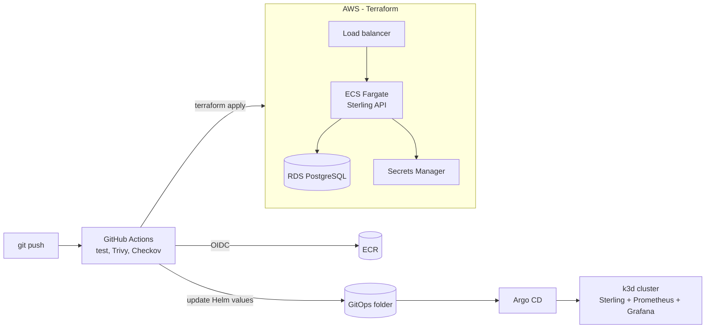

# Ironclad

**Deploying a real application to AWS the way a platform team would: infrastructure as code, Kubernetes with GitOps, monitoring, and security checks in CI**

Terraform · AWS (VPC, ECS Fargate, RDS, S3, ECR) · Docker · k3d + Helm · Argo CD · Prometheus · Grafana · Trivy · Checkov · GitHub Actions (OIDC) · Claude API · OpenAI API · custom LLMs

> **Status: under active development.** This README is the design spec. The checklist in the [Roadmap](#roadmap) shows what is built so far.

---

## Overview

Ironclad takes the [Sterling](https://github.com/striderzz/Sterling) payments API and runs it two ways:

1. **On AWS**, built entirely with Terraform: a VPC with public and private subnets, the API on ECS Fargate behind a load balancer, PostgreSQL on RDS, and images in ECR.
2. **On Kubernetes**, locally with k3d (free): Helm charts deployed by Argo CD from Git, with Prometheus and Grafana monitoring.

The CI/CD pipeline builds, scans and deploys every change. Trivy scans the images and Checkov scans the Terraform, and AWS access uses short-lived OIDC credentials instead of stored keys.

| Area | What it shows |
|---|---|
| **Cloud** | VPC networking, ECS Fargate, RDS, IAM least-privilege roles, Terraform modules and remote state |
| **DevOps** | Docker, Helm, GitOps with Argo CD, GitHub Actions pipelines |
| **Security and reliability** | Image and IaC scanning, secrets in AWS Secrets Manager, dashboards and alerts |

## Architecture



## Key features

- Reusable Terraform modules (network, database, service) with remote state in S3
- Zero long-lived AWS keys: GitHub Actions assumes an IAM role through OIDC
- Pipeline fails on critical image vulnerabilities or insecure Terraform
- Argo CD keeps the cluster in sync with Git and rolls back by reverting a commit
- Grafana dashboard for request rate, errors and latency, with an alert rule
- A `make destroy` step and cost notes, so the AWS bill stays small

## Results to publish (only from real runs)

| Metric | How it is measured |
|---|---|
| Time from push to running in production | CI timings |
| Issues caught by Trivy and Checkov | Pipeline reports |
| Monthly AWS cost | Cost Explorer / Infracost estimate |

## AI features

- **AI pull-request reviewer:** a GitHub Action sends the `terraform plan`, the Checkov and Trivy findings, and the Infracost diff to Claude. It posts one PR comment with a **structured risk report**: what changes, severity per finding, cost impact, and a suggested fix for each issue.
- **Alert explainer:** when a Grafana alert fires, a small webhook asks Claude to summarise the alert, the related metrics and the last deploy in plain English, and posts the summary to Slack or Discord.
- Both run on Claude by default and can be switched to OpenAI or a custom model with one setting.

## LLM providers and API keys

Every AI feature goes through one small provider layer, so you can switch models without touching the rest of the code.

| Provider | How it is called | Used for |
|---|---|---|
| **Claude** (default) | Official `anthropic` Python SDK | Reasoning, tool use, structured outputs, vision, PDF citations |
| **OpenAI** | Official `openai` Python SDK | Alternative chat model, embeddings, speech-to-text |
| **Custom LLM** | Any OpenAI-compatible endpoint: base URL + API key + model name | Gemini, Groq, DeepSeek, OpenRouter, a local Ollama model, or anything else not listed |

**Setting keys:** use either option.
1. Copy `.env.example` to `.env` and fill in `ANTHROPIC_API_KEY`, `OPENAI_API_KEY`, or the `CUSTOM_LLM_*` values.
2. For the GitHub Action, store keys as **repository secrets** and pick the provider and model with repository variables (`LLM_PROVIDER`, `LLM_MODEL`, `CUSTOM_LLM_BASE_URL`). A `python -m ironclad_ai.check` command tests the connection. Keys are never printed in logs.

**Staying within budget:**
- Each call's tokens and cost are logged.
- A monthly budget cap (`LLM_MONTHLY_BUDGET_USD`) stops AI calls once it is reached.
- Long, stable prompts use prompt caching.
- Offline evaluations run through the Message Batches API at half the price.
- Bulk steps can use a cheaper model, chosen per feature with environment variables. The defaults are `claude-opus-5-5` for the main reasoning step and `claude-haiku-5-5` for bulk steps.

## Repository structure

```
Ironclad/
├── requirements.txt
├── .env.example
├── terraform/        # modules + environments
├── helm/             # Sterling chart
├── gitops/           # Argo CD applications
├── monitoring/       # Prometheus rules, Grafana dashboards
├── docs/             # architecture, screenshots, cost notes
└── .github/workflows/
```

## Roadmap

- [ ] Provider layer (Claude, OpenAI, custom) + budget cap
- [ ] Terraform network + RDS + ECS Fargate deployment of Sterling
- [ ] GitHub Actions CI/CD with OIDC
- [ ] Trivy and Checkov gates
- [ ] k3d cluster with Helm chart and Argo CD
- [ ] Prometheus + Grafana dashboard and alert
- [ ] AI features + provider comparison
- [ ] Screenshots, cost notes, demo GIF

## Author

**Hasan Mohd Hussain**: [GitHub](https://github.com/striderzz) · [LinkedIn](https://www.linkedin.com/in/hasan-m-4b1bba315/) · [Portfolio](https://striderzz.github.io/portfolio-website/)
