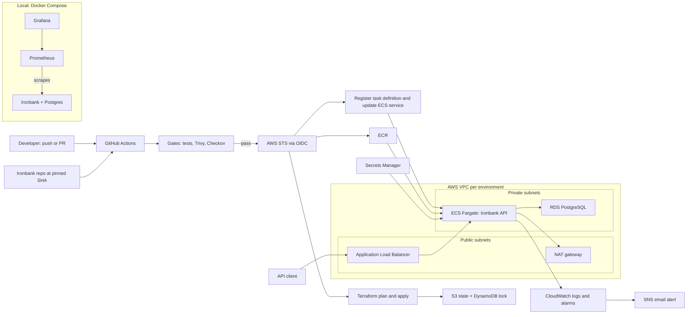

# Endurance – AWS DevOps

Deploys the Ironbank payments API to AWS with Terraform and a GitHub Actions pipeline that scans every image and every infrastructure change before it ships.

Status: in development — design spec and build plan; results land as each phase ships.

       

---

## Why this exists

Most portfolio deployments stop at "it runs on my laptop" or a console-clicked EC2 instance with an access key pasted into CI. That skips the parts a platform team actually owns: a network that keeps the database off the internet, infrastructure that can be rebuilt from code, a pipeline that refuses to ship a vulnerable image, credentials that expire on their own, alarms that fire before users notice, a rollback that takes one command, and a bill that goes to zero when the demo is over. Endurance takes a real service, the [Ironbank payments API](https://github.com/striderzz/ironbank-payments-ledger), and deploys it that way.

## What it does

- Builds the whole AWS environment from Terraform modules: VPC with public and private subnets, ALB, ECS Fargate service, RDS PostgreSQL, ECR, Secrets Manager, CloudWatch logs and alarms, and least-privilege IAM roles
- Keeps Terraform state in S3 with a DynamoDB lock table, so two people (or two pipeline runs) cannot apply at the same time
- Runs dev and prod from the same code, with differences (sizes, task count, Multi-AZ, deletion protection) in `dev.tfvars` and `prod.tfvars`
- Gates every change in GitHub Actions: lint and tests, a Docker build, a Trivy image scan and a Checkov IaC scan; a critical finding fails the run
- Authenticates GitHub Actions to AWS with OIDC, so the repo stores no long-lived AWS keys
- Pushes images to ECR tagged with the commit SHA and deploys them to ECS as a new task definition revision; prod waits for a manual approval
- Rolls back by redeploying the previous task definition revision (`make rollback`), with the ECS deployment circuit breaker as an automatic backstop
- Runs the API locally with Prometheus and Grafana dashboards through Docker Compose, and tears all AWS resources down with `make destroy`

## Architecture



A push or pull request starts GitHub Actions, which checks out Ironbank at the commit pinned in `ironbank.ref`, runs its tests, builds the image and runs Trivy on it, and runs Checkov on the Terraform. Only if every gate passes does the job exchange its GitHub OIDC token for short-lived AWS credentials. On `main`, it pushes the image to ECR, applies Terraform for the target environment, registers a new ECS task definition that points at the new image, and waits for the service to become stable behind the ALB. Inside AWS, only the ALB sits in public subnets; the Fargate tasks and the RDS database live in private subnets, the tasks read the database password from Secrets Manager at start-up, and logs and metrics go to CloudWatch, where alarms notify an SNS email topic. Locally, the same API runs under Docker Compose next to Prometheus and Grafana, so dashboards and alert rules can be built without paying for AWS.

## How it works

### Terraform layout and remote state

The code is split into small modules (`network`, `ecr`, `database`, `iam`, `service`, `monitoring`) wired together by one root module in `terraform/live/`. Each environment has its own `*.tfvars` file and its own backend file that points at a separate state key in the same S3 bucket. A separate `terraform/bootstrap/` stack creates the state bucket (versioned, encrypted, public access blocked), the DynamoDB lock table, and the GitHub OIDC provider and CI roles; it is applied once by hand because the pipeline cannot create the thing it authenticates with. One root module plus tfvars keeps dev and prod structurally identical, so a change tested in dev is the same change that reaches prod.

### Network

The VPC spans two availability zones. Public subnets hold the ALB and the NAT gateway; private subnets hold the ECS tasks and RDS. Security groups reference each other instead of CIDR ranges: the ALB accepts HTTP/HTTPS from the internet, the tasks accept the app port only from the ALB's security group, and RDS accepts 5432 only from the tasks' security group. Dev uses a single NAT gateway to keep cost down; prod can set one per AZ in `prod.tfvars`. This trade-off (one shared NAT is a single point of failure for outbound traffic) is written down in `docs/cost.md`.

### Compute: ECS Fargate behind an ALB

Ironbank runs as an ECS service on Fargate with `awsvpc` networking, registered in an ALB target group of type `ip`. The ALB health check calls the API's health endpoint, and ECS replaces any task that fails it. Fargate was chosen over EKS because one stateless API does not need a Kubernetes control plane, and every part of it (task definition, service, target group) can be explained line by line. Terraform creates the service but ignores changes to its `task_definition`, because the pipeline owns image rollouts; otherwise every `terraform apply` would undo the last deploy.

### Database and secrets

RDS PostgreSQL runs in private subnets with storage encryption and automated backups. Terraform enables RDS-managed master credentials, so AWS generates the password and stores it in Secrets Manager; the password never appears in Terraform code, tfvars or state. The task definition references the secret ARN in its `secrets` block, and only the task execution role may read that one secret. Dev skips the final snapshot and turns off deletion protection so `make destroy` works; prod keeps both on and can enable Multi-AZ.

### IAM and OIDC

There are four roles, each scoped to what it touches: the ECS task execution role (pull from this ECR repo, write to this log group, read this secret), the ECS task role (whatever Ironbank itself needs, empty by default), a CI plan role (read-only, used on pull requests), and a CI deploy role (push to ECR, register task definitions, update the service, apply Terraform). The CI roles trust GitHub's OIDC provider, and the trust policy checks the token's `aud` and `sub` claims, so only this repository's `main` branch or its `prod` environment can assume the deploy role. Tokens last for the job and nothing long-lived is stored in GitHub secrets.

### Pipeline and security gates

Pull requests run `terraform fmt -check`, `terraform validate`, `tflint`, Ironbank's tests, a Docker build, Trivy and Checkov, and post the `terraform plan` output to the run summary. Trivy fails the build on CRITICAL or HIGH vulnerabilities that have a fix available; Checkov fails on any failed policy. Accepted exceptions live in `.trivyignore` and inline `checkov:skip` comments, each with a reason, so suppressions are reviewed like code. Merges to `main` repeat the gates, push the image to ECR with an immutable SHA tag, deploy to dev, run a smoke test through the ALB, and then wait for approval on the `prod` GitHub environment before deploying the same image to prod.

### Monitoring

In AWS, containers log to a CloudWatch log group with a set retention period, and CloudWatch alarms watch ALB 5xx count, target response time, unhealthy host count, ECS CPU and memory, and RDS CPU and free storage; alarms publish to an SNS topic that emails the owner. Locally, `docker compose up` starts Ironbank, Postgres, Prometheus and Grafana; Prometheus scrapes the API's metrics endpoint and Grafana loads a provisioned dashboard for request rate, error rate and latency (the RED method) plus one alert rule on error rate. Keeping Prometheus and Grafana local avoids paying for an always-on monitoring stack in AWS.

### Rollback

Every deploy creates a new task definition revision and leaves the old one in place. `make rollback ENV=dev` looks up the revision before the current one, updates the service to use it, waits for the service to stabilize and reruns the smoke test. The ECS deployment circuit breaker is also on, so a deploy whose tasks never pass health checks rolls back on its own. Database changes are not rolled back by this; Ironbank migrations must stay backward compatible for one release so the previous image still works against the new schema.

### Cost control

Everything in an environment is created by Terraform and removed by `make destroy ENV=dev`. Dev settings exist to make that clean: no final RDS snapshot, no deletion protection, ECR `force_delete`, and a zero-day recovery window on secrets. The bootstrap stack (state bucket and lock table) is kept and destroyed separately. Which parts fall under the AWS free tier depends on the account: accounts opened after AWS changed its free tier in mid-2025 get a credit-based free plan instead of the older 12-month free tier, so check your own account's terms before applying.

| Resource | Free tier | Notes |
|---|---|---|
| S3 state bucket, DynamoDB lock table | Usually within free-tier limits | Tiny storage and request volume |
| ECR | Small storage allowance on the 12-month free tier | A lifecycle policy keeps only recent images |
| RDS PostgreSQL, single-AZ micro instance | Covered by the 12-month free tier on eligible accounts | Multi-AZ and larger classes are paid |
| ALB | Hours included on the 12-month free tier for eligible accounts | Also billed on load balancer capacity units |
| ECS Fargate | Not free tier | Billed per vCPU and GB of memory while tasks run |
| NAT gateway | Not free tier | Hourly plus per GB processed; the main reason to destroy dev after a session |
| Secrets Manager | 30-day trial per secret | Then billed per secret per month plus API calls |
| CloudWatch logs and alarms | Basic free tier for logs and a small number of alarms | Retention is set short in dev |
| Public IPv4 addresses | Not free | AWS bills public IPv4 per hour, including those on the ALB and NAT |

Real cost numbers come only from the AWS Pricing Calculator or Cost Explorer and are recorded under Results.

## Tech stack

| Layer | Tools | Why |
|---|---|---|
| Infrastructure as code | Terraform, tflint | Cloud-agnostic, plan-before-apply workflow, the most common IaC tool in job posts |
| Remote state | S3 + DynamoDB | Shared, versioned state with locking so concurrent applies cannot corrupt it |
| Network | VPC, public and private subnets, NAT gateway, security groups | Keeps the database and tasks off the public internet |
| Compute | ECS Fargate | Runs containers without managing servers or a Kubernetes control plane |
| Load balancing | Application Load Balancer | Health checks, HTTP routing, rolling deploys without downtime |
| Database | RDS PostgreSQL | Managed backups and patching for the database Ironbank already uses |
| Registry | ECR | Private image registry in the same account, with immutable tags and scan on push |
| Secrets | Secrets Manager | Database password generated and stored by AWS, injected at task start |
| Identity | IAM, GitHub OIDC provider | Least-privilege roles and short-lived CI credentials |
| CI/CD | GitHub Actions | Lives next to the code; environments give a manual prod approval |
| Security scanning | Trivy, Checkov | Image CVEs and IaC misconfigurations caught before deploy |
| Containers | Docker, Docker Compose | Same image locally and in AWS; one command for the local stack |
| Monitoring | CloudWatch, Prometheus, Grafana | CloudWatch for AWS, Prometheus and Grafana locally at no cost |
| Automation | Make, Bash | One entry point for local and AWS tasks |

## Project structure

```
endurance-aws-devops/
├── .github/
│   └── workflows/
│       ├── ci.yml              # PR: lint, test, build, Trivy, Checkov, terraform plan
│       └── deploy.yml          # main: build, scan, push to ECR, deploy dev, prod after approval
├── terraform/
│   ├── bootstrap/              # state bucket, lock table, GitHub OIDC provider, CI roles
│   ├── modules/
│   │   ├── network/            # VPC, subnets, NAT gateway, route tables
│   │   ├── ecr/                # repository, lifecycle policy, scan on push
│   │   ├── database/           # RDS PostgreSQL, subnet group, security group
│   │   ├── iam/                # task execution role, task role
│   │   ├── service/            # ECS cluster, task definition, service, ALB, target group
│   │   └── monitoring/         # log group, CloudWatch alarms, SNS topic
│   └── live/                   # root module that wires the modules together
│       ├── main.tf
│       ├── variables.tf
│       ├── outputs.tf
│       ├── dev.tfvars
│       ├── prod.tfvars
│       ├── dev.backend.hcl
│       └── prod.backend.hcl
├── monitoring/
│   ├── prometheus/             # prometheus.yml, alert rules
│   └── grafana/                # provisioned datasource and dashboard JSON
├── scripts/
│   ├── rollback.sh             # redeploy the previous task definition revision
│   └── smoke-test.sh           # call the health endpoint through the ALB
├── docs/
│   ├── runbooks/               # rollback, destroy, secret rotation
│   ├── cost.md                 # free-tier and paid resources, how to keep the bill small
│   ├── results/                # raw measurement output
│   └── screenshots/
├── docker-compose.yml          # local Ironbank, Postgres, Prometheus, Grafana
├── ironbank.ref                # pinned Ironbank commit SHA to build and deploy
├── Makefile
├── .env.example
├── .pre-commit-config.yaml
├── .tflint.hcl
├── .checkov.yaml
├── .trivyignore
├── README.md
├── INFO.md                     # interview prep notes
└── CLAUDE.md                   # build plan for Claude Code
```

## Getting started

This is the target workflow once Phase 1 lands. AWS steps arrive in Phases 2 and 3.

**Prerequisites**

- Docker with Docker Compose v2
- Make and Git
- For AWS: Terraform 1.x, AWS CLI v2, an AWS account you can create IAM roles in, and a configured CLI profile for the one-time bootstrap
- Optional locally: `tflint`, `trivy`, `checkov` (the Makefile falls back to their Docker images)

**Run locally**

```bash
git clone https://github.com/striderzz/endurance-aws-devops.git
cd endurance-aws-devops
cp .env.example .env          # local Postgres and Grafana passwords, AWS region, alert email
make up                       # Ironbank + Postgres via docker compose (Prometheus and Grafana join in Phase 5)
```

From Phase 5, Grafana is at `http://localhost:3000` and Prometheus at `http://localhost:9090`. Stop with `make down`.

**Lint, test and scan**

```bash
make test                     # Ironbank tests, terraform fmt/validate, tflint
make scan                     # Trivy on the local image, Checkov on terraform/
```

**Deploy to AWS (dev)**

```bash
make bootstrap                # once: state bucket, lock table, OIDC provider, CI roles
make plan ENV=dev
make apply ENV=dev
make deploy ENV=dev           # build, push to ECR, roll out a new task definition
make rollback ENV=dev         # back to the previous task definition revision
make destroy ENV=dev          # remove every dev resource when you are done
```

After bootstrap, set the CI role ARNs as GitHub repository variables and create a `prod` environment with required reviewers; from then on, deploys run from GitHub Actions. Setting an AWS Budgets alert on the account before the first apply is a good habit.

## Results

All values are placeholders until measured from real runs in this repo.

| Metric | Value | How it is measured |
|---|---|---|
| Deploy lead time (commit to live in dev) | — | Commit timestamp to the smoke test passing after `aws ecs wait services-stable`, from GitHub Actions run timestamps; median of 10 runs. Measured after Phase 4; raw output in docs/results/ |
| Pipeline duration | — | Wall-clock time of the `deploy.yml` run, split per job (gates, push, deploy); median of 10 runs. Measured after Phase 4; raw output in docs/results/ |
| Time to roll back | — | From starting `make rollback` to the previous revision stable and the smoke test passing, tested by deploying a deliberately broken image. Measured after Phase 6; raw output in docs/results/ |
| Security findings blocked | — | Count of Trivy and Checkov findings that failed a run, grouped by severity and by fixed versus suppressed, from the SARIF reports. Measured after Phase 4; raw output in docs/results/ |
| Monthly cost estimate (dev, prod) | — | AWS Pricing Calculator for the resources in each tfvars file, checked against Cost Explorer after a real dev run (Infracost if the stretch goal ships). Measured after Phase 6; raw output in docs/results/ |

## Roadmap

- [ ] Phase 1: scaffold, Makefile, pre-commit, CI lint workflow, local Docker Compose stack
- [ ] Phase 2: bootstrap (S3 state, DynamoDB lock, OIDC provider, CI roles) and network module
- [ ] Phase 3: ECR, RDS, Secrets Manager, IAM, ECS Fargate service and ALB; first deploy to dev
- [ ] Phase 4: GitHub Actions pipeline with Trivy and Checkov gates, OIDC deploy to dev and prod
- [ ] Phase 5: CloudWatch logs and alarms; Prometheus and Grafana dashboards locally
- [ ] Phase 6: rollback, `make destroy`, cost notes, measured results and screenshots

## Stretch goals

- Local Kubernetes with k3d, a Helm chart for Ironbank, and Argo CD syncing from a `gitops/` folder
- Blue/green deploys on ECS with CodeDeploy and automatic rollback on alarm
- An AI pull-request reviewer: a GitHub Action sends the `terraform plan` and scanner output to Claude (`claude-haiku-5-5`) and posts one structured risk comment, with token and cost logging and a monthly budget cap
- Infracost cost diff on every pull request that changes Terraform

## Related projects

- [Ironbank – Payments Ledger](https://github.com/striderzz/ironbank-payments-ledger): the API this project builds and deploys
- [Jarvis – Incident Agents](https://github.com/striderzz/jarvis-incident-agents): agents that investigate incidents in Ironbank, using the logs, metrics and alarms set up here

## Author

Hasan · [GitHub](https://github.com/striderzz) · [LinkedIn](https://www.linkedin.com/in/hasan-m-4b1bba315) · [Portfolio](https://striderzz.github.io/portfolio-website)

## License

MIT
